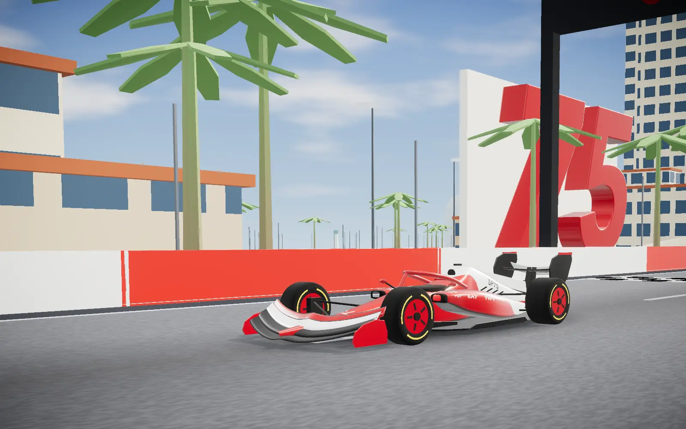
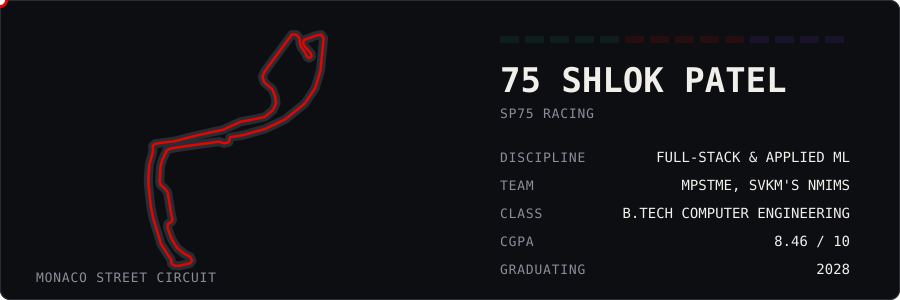

<picture>
  <source media="(prefers-color-scheme: dark)" srcset="assets/hero-night.webp">
  
</picture>

# Shlok Patel

**Computer Engineering student building full-stack systems and applied machine learning.**

## Lights out

I'm a third-year B.Tech Computer Engineering student at MPSTME, SVKM's NMIMS. I work across the stack: React front ends, Node and FastAPI back ends, PostgreSQL, and the ML pipelines that sit behind them.

I like problems with real constraints. A petrol pump can't stop serving trucks because a model crashed. A satellite assistant shouldn't invent a percentage it can't back up. Most of my projects are built around that kind of rule.

## The classification

| Pos | Entry | What it does | Best sector | Links |
|:---:|:---|:---|:---|:---|
| 1 | **Fleet Credit Tracker** | A petrol pump's paper credit ledger, rebuilt as a three-service platform with fraud detection. | `3.1% false +` | [Live](https://fleet-credit-tracker.vercel.app) · [Code](https://github.com/shlok7120/fleet-credit-tracker) |
| 2 | **SatQuery AI** | Ask a satellite image a question and get an answer backed by evidence and a replayable audit trail. Team of 6, SIH 2026. | `292 tests` | [Code](https://github.com/harshkulkarni2234/SatQuery-Ai_SIH) |
| 3 | **TimeWeave** | Timetable generation that compares seven AI search techniques and explains why a schedule can't exist. With Khush Patel. | `10^190 space` | [Live](https://timeweave-one.vercel.app) · [Code](https://github.com/shlok7120/Timeweave) |
| 4 | **TDA Skin Lesion Study** | Testing whether the shape of a skin lesion, measured with topology, can make a deep learning classifier better. With Pranjal Girase. | `0.697 macro-F1` | |
| 5 | **Tether** | Browser-to-browser file transfer over WebRTC, where the server never touches your files. | `0 bytes stored` | [Code](https://github.com/shlok7120/tether) |
| 6 | **Case 43: MFA Recovery** | A case study of an AI-written account recovery flow that was weaker than the login it backed up. | `19 tests` | |
| 7 | **Athletix** | An Android workout logger with live route tracking, photos and an on-device history. Team project. | `Android` | [Code](https://github.com/khushhh-14/Athletix-Android-App) |
| 8 | **Image Sharpening Studio** | A benchmark of spatial and frequency domain sharpening, with an interactive studio for tuning it. Team project. | `24.95 dB best` | [Code](https://github.com/Parth-3107/IVP-Image-sharpening-Toolkit-) |

## Car setup

Tyre compounds show how well I know each tool: **Hard** is production-ready, **Medium** is comfortable, **Soft** is still learning.

| Part | Area | Hard | Medium | Soft |
|:---|:---|:---|:---|:---|
| Power unit | Backend | Node.js & Express, Python FastAPI, REST APIs, JWT, bcrypt & role-based access | Flask | |
| Aerodynamics | Frontend | React 19, Vite, Tailwind CSS | React Router, Recharts | |
| Telemetry | Data & ML | PostgreSQL | scikit-learn, pandas & NumPy, OpenCV | statsmodels, MongoDB |
| Chassis | Languages | JavaScript, Python | SQL, C++, Java | |
| Pit crew | Tools | Git & GitHub | Vercel, Render, Linux & macOS | |

## Team radio

> **Box box.** Open to internships and project collaborations. The fastest way to reach me is [email](mailto:shlok7120.sp@gmail.com) or [LinkedIn](https://www.linkedin.com/in/shlok-patel-028847367/).

<!-- After deploying the portfolio, add its link here: [Drive the lap](https://your-site.vercel.app) -->
