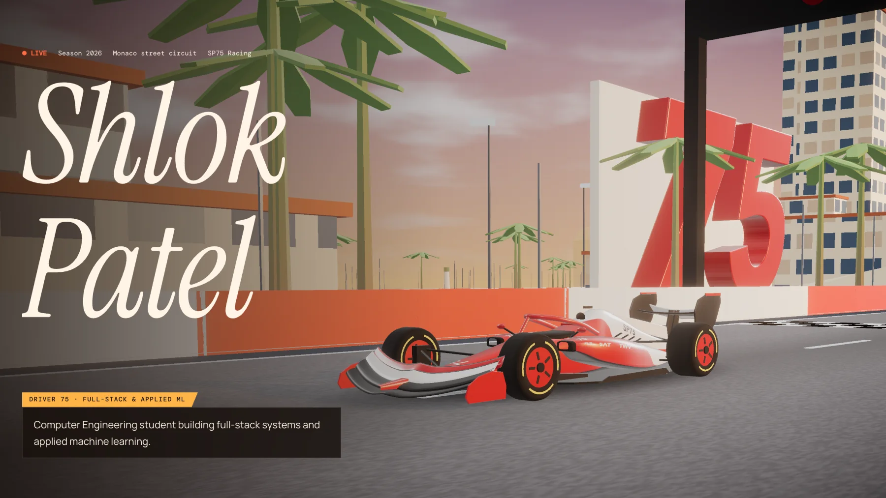
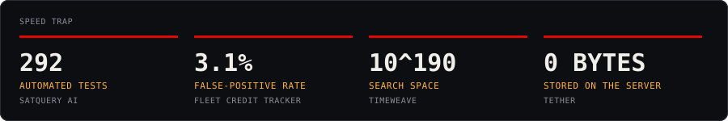
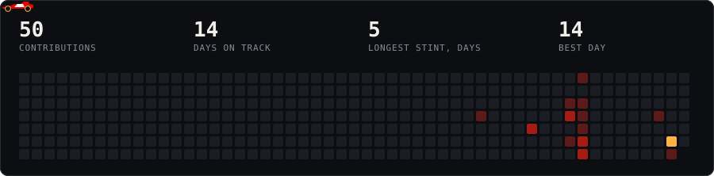

## Pick your strategy

<b>Soft tyres:</b> I've got 30 seconds

 

Third-year Computer Engineering student, CGPA 8.46. I build multi-service web apps and put ML behind them. Start with [Fleet Credit Tracker](https://fleet-credit-tracker.vercel.app), then [email me](mailto:shlok7120.sp@gmail.com).

<b>Medium tyres:</b> Show me the best two projects

 

- [**Fleet Credit Tracker**](https://github.com/shlok7120/fleet-credit-tracker): a solo build with three services and fraud detection. The ML service is an advisor, so if Python goes down, fuelling carries on.
- [**TimeWeave**](https://github.com/shlok7120/Timeweave): seven AI search techniques written from scratch, compared fairly, with an explanation when no schedule can exist.

<b>Hard tyres:</b> I want the full race

 

Keep scrolling: the numbers, the classification, what went wrong, and the car setup are all below.

## Lights out

I'm a third-year B.Tech Computer Engineering student at MPSTME, SVKM's NMIMS. I work across the stack: React front ends, Node and FastAPI back ends, PostgreSQL, and the ML pipelines that sit behind them.

I like problems with real constraints. A petrol pump can't stop serving trucks because a model crashed. A satellite assistant shouldn't invent a percentage it can't back up. Most of my projects are built around that kind of rule.

## The classification

| Pos | Entry | What it does | Best sector | Links |
|:---:|:---|:---|:---|:---|
| 1 | **Fleet Credit Tracker** | A petrol pump's paper credit ledger, rebuilt as a three-service platform with fraud detection. | `3.1% false +` | [Live](https://fleet-credit-tracker.vercel.app) · [Code](https://github.com/shlok7120/fleet-credit-tracker) |
| 2 | **SatQuery AI** | Ask a satellite image a question and get an answer backed by evidence and a replayable audit trail. Team of 6, SIH 2026. | `292 tests` | [Code](https://github.com/harshkulkarni2234/SatQuery-Ai_SIH) |
| 3 | **TimeWeave** | Timetable generation that compares seven AI search techniques and explains why a schedule can't exist. With Khush Patel. | `10^190 space` | [Live](https://timeweave-one.vercel.app) · [Code](https://github.com/shlok7120/Timeweave) |
| 4 | **TDA Skin Lesion Study** | Testing whether the shape of a skin lesion, measured with topology, can make a deep learning classifier better. With Pranjal Girase. | `0.697 macro-F1` | |
| 5 | **Tether** | Browser-to-browser file transfer over WebRTC, where the server never touches your files. | `0 bytes stored` | [Code](https://github.com/shlok7120/tether) |
| 6 | **Case 43: MFA Recovery** | A case study of an AI-written account recovery flow that was weaker than the login it backed up. | `19 tests` | |
| 7 | **Athletix** | An Android workout logger with live route tracking, photos and an on-device history. Team project. | `Android` | [Code](https://github.com/khushhh-14/Athletix-Android-App) |
| 8 | **Image Sharpening Studio** | A benchmark of spatial and frequency domain sharpening, with an interactive studio for tuning it. Team project. | `24.95 dB best` | [Code](https://github.com/Parth-3107/IVP-Image-sharpening-Toolkit-) |

## Race control

Real incidents from Fleet Credit Tracker. Open one to see what happened.

<b>Investigation 1:</b> Every fill failed in production

 

A patch for exact money arithmetic rewrote a call to `lineTotal()` but missed its import, so the fill endpoint returned a 500 and no fill could be recorded.

**Verdict:** I restored the import and worked out why my check had passed: the search matched the usage line, so it proved nothing about the import.

<b>Investigation 2:</b> A paisa out on 7 of 619 fills

 

JavaScript floats and Postgres NUMERIC round differently. 28.13 litres at 102.50 came to 2883.32 in one and 2883.33 in the other. Nothing failed loudly, and an audit found it.

**Verdict:** Moved totals to exact money arithmetic.

<b>Investigation 3:</b> An open billing endpoint

 

The cron guard skipped itself when its secret was unset, so a missing variable left a public endpoint that emails every client their invoice.

**Verdict:** Made it fail closed, because a security control should never be switched off by its own absence.

<b>Investigation 4:</b> Midnight fills in the wrong month

 

Billing used the database session's timezone, which was UTC, so a fill at 00:30 IST on the 1st landed in the previous month.

**Verdict:** Cycle boundaries now use the pump's own timezone.

## Car setup

Tyre compounds show how well I know each tool: **Hard** is production-ready, **Medium** is comfortable, **Soft** is still learning.

| Part | Area | Hard | Medium | Soft |
|:---|:---|:---|:---|:---|
| Power unit | Backend | Node.js & Express, Python FastAPI, REST APIs, JWT, bcrypt & role-based access | Flask | |
| Aerodynamics | Frontend | React 19, Vite, Tailwind CSS | React Router, Recharts | |
| Telemetry | Data & ML | PostgreSQL | scikit-learn, pandas & NumPy, OpenCV | statsmodels, MongoDB |
| Chassis | Languages | JavaScript, Python | SQL, C++, Java | |
| Pit crew | Tools | Git & GitHub | Vercel, Render, Linux & macOS | |

## The season so far

Car 75 drives through my real contribution calendar. A GitHub Action redraws it every day.

## Team radio

> **Box box.** Open to internships and project collaborations. The fastest way to reach me is [email](mailto:shlok7120.sp@gmail.com) or [LinkedIn](https://www.linkedin.com/in/shlok-patel-028847367/).

<!-- After deploying the portfolio, add its link here: [Drive the lap](https://your-site.vercel.app) -->

